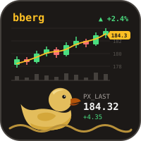

<p align="center">
  
</p>

<h1 align="center">bberg</h1>

<p align="center">
  A DuckDB extension for querying Bloomberg Data License files with SQL.
</p>

<p align="center">
  <a href="https://github.com/wdorninger/ddb_bberg-releases/releases"></a>
  
  
</p>

---

`bberg` reads Bloomberg Data License request/reply files directly into DuckDB: `getdata` and `gethistory`
output (`.out`) and `getactions` corporate-action files (`.cax`), plain or gzip-compressed, local or on
object storage. There is no conversion step; the files are queried in place.

## Try it in the browser

Both extensions, `bberg` and `mt564`, can be tried without installing anything at
**[ddb-gcloud.web.app](https://ddb-gcloud.web.app/)** (DuckFin). The page runs DuckDB-Wasm in the browser with
the extensions preloaded: drop in your own `.out`, `.cax` or MT564 files and query them with SQL. Files are
processed locally in the browser and are not uploaded. The page also offers the native binaries for
download.

The web application is maintained in the [ddb_gcloud](https://github.com/wdorninger/ddb_gcloud) project.

## Using bberg with the DuckDB JDBC driver

The extension can be loaded into any Java application that uses the
[DuckDB JDBC driver](https://duckdb.org/docs/stable/clients/java) in in-memory mode.

**1. Add the driver** (version 1.5.6.0 or newer):

```xml
<dependency>
  <groupId>org.duckdb</groupId>
  <artifactId>duckdb_jdbc</artifactId>
  <version>1.5.6.0</version>
</dependency>
```

**2. Download** the binary for your platform from the
[Releases](https://github.com/wdorninger/ddb_bberg-releases/releases) page, for example
`bberg.linux_amd64.duckdb_extension`.

**3. Allow unsigned extensions and load the file.**

> [!IMPORTANT]
> `bberg` is not signed with DuckDB's extension signing key. DuckDB refuses to load unsigned extensions unless
> signature checking is switched off with the `allow_unsigned_extensions` setting. This setting can only be
> given when the database is opened, so pass it in the connection properties. Running
> `SET allow_unsigned_extensions = true` on an open connection fails.

```java
import java.sql.*;
import java.util.Properties;

Properties props = new Properties();
props.setProperty("allow_unsigned_extensions", "true");     // switch off signature checking

try (Connection conn = DriverManager.getConnection("jdbc:duckdb:", props);   // in-memory database
     Statement stmt = conn.createStatement()) {

    stmt.execute("LOAD '/opt/duckdb/extensions/bberg.linux_amd64.duckdb_extension'");

    try (ResultSet rs = stmt.executeQuery(
            "SELECT TICKER, PX_LAST FROM read_bberg('/data/bbg/prices.out', bloomberg_nulls = true)")) {
        while (rs.next()) {
            System.out.println(rs.getString("TICKER") + "  " + rs.getDouble("PX_LAST"));
        }
    }
}
```

Without the property, `LOAD` fails with
`... could not be loaded because its signature is either missing or invalid and unsigned extensions are
disabled by configuration (allow_unsigned_extensions)`.

Each `jdbc:duckdb:` connection opens a separate in-memory database, and an extension is loaded per database.
Connections created with `DuckDBConnection.duplicate()` share the database and see the extension. When using
a connection pool, run the `LOAD` statement as the pool's connection-init SQL. See
[docs/jdbc.md](docs/jdbc.md) for details.

## Functions

| Function | Reads | Description |
|---|---|---|
| [`read_bberg(path, ...)`](docs/bberg.md) | `.out`, `.out.gz` | `getdata` and `gethistory` replies. One row per security (or per security and date with `hist = true`), one typed column per requested field. |
| [`read_bbcax(path, ...)`](docs/bbcax.md) | `.cax`, `.cax.gz` | `getactions` corporate-action replies. The fixed action header as columns, and the action-specific fields either as a map or, with `action = '...'`, as typed columns. |

Both functions accept a file, a directory, a glob or a list of these, and both register a replacement scan:
`SELECT * FROM 'prices.out'` and `SELECT * FROM 'actions.cax'` call the right reader automatically.

## Example

Using the sample file [`examples/prices.out`](examples/prices.out):

```sql
LOAD 'bberg.linux_amd64.duckdb_extension';

SELECT TICKER, NAME, CRNCY, PX_LAST, PX_VOLUME, LAST_UPDATE_DT
FROM read_bberg('examples/prices.out', bloomberg_nulls = true)
WHERE ERROR_CODE = 0
ORDER BY TICKER;
```

| TICKER | NAME | CRNCY | PX_LAST | PX_VOLUME | LAST_UPDATE_DT |
|---|---|---|---:|---:|---|
| FTHR | FEDERWERK AG | EUR | 92.1 | NULL | 2026-01-13 |
| MRSH | MARSHLAND UTILITIES PLC | GBp | 1268.5 | 412900 | 2026-01-14 |
| PDL | PUDDLE LOGISTICS CORP | USD | 47.05 | 880150 | 2026-01-14 |
| QKW | QUACKWORKS INC | USD | 184.32 | 2315400 | 2026-01-14 |
| WDDL | WADDLE SA | EUR | 15.884 | 1904330 | 2026-01-14 |

Column types are detected from the data: `PX_LAST` is `DOUBLE`, `PX_VOLUME` is `BIGINT` and
`LAST_UPDATE_DT` is `DATE`. Bloomberg's `N.A.` placeholder becomes `NULL`.

Corporate actions, with the fields of one action type as typed columns:

```sql
SELECT SECURITY_DESC, ACTION_FLAG, CP_RECORD_DT, CP_PAY_DT, CP_GROSS_AMT, CP_DVD_CRNCY
FROM read_bbcax('examples/actions.cax', action = 'DVD_CASH', bloomberg_nulls = true)
WHERE ACTION_FLAG <> 'D'
ORDER BY CP_PAY_DT;
```

| SECURITY_DESC | ACTION_FLAG | CP_RECORD_DT | CP_PAY_DT | CP_GROSS_AMT | CP_DVD_CRNCY |
|---|---|---|---|---:|---|
| MRSH LN Equity | U | 2026-01-23 | 2026-02-20 | 31.25 | GBp |
| QKW US Equity | N | 2026-02-13 | 2026-02-27 | 0.54 | USD |

More examples are in the [function reference](docs/bberg.md#examples).

## Downloads

| File | Platform |
|---|---|
| `bberg.linux_amd64.duckdb_extension` | Linux x86-64 (glibc 2.28 or newer) |
| `bberg.osx_arm64.duckdb_extension` | macOS on Apple silicon (macOS 11 or newer) |
| `bberg.osx_amd64.duckdb_extension` | macOS on Intel (macOS 11 or newer) |
| `bberg.windows_amd64.duckdb_extension` | Windows x86-64 |
| `bberg.duckdb_extension.wasm` | DuckDB-Wasm (`wasm_eh`), browser and Node.js |
| `SHA256SUMS` | SHA-256 checksums of the files above |

Verify a download with `sha256sum -c SHA256SUMS --ignore-missing`.

Keep the file name starting with `bberg.`. DuckDB derives the extension name from the part before the first
dot.

This repository publishes compiled binaries and documentation only. The source code is not public.

## Compatibility

`bberg` works with DuckDB 1.5.6 and newer, including 2.0.x. It is built against DuckDB's stable C extension
API (v1.5.6), so one binary loads into every later DuckDB release without a rebuild. Remote file systems
(`httpfs`, S3, GCS, Azure), secrets and caching are provided by the DuckDB instance that loads the extension.

## Other clients

All clients need unsigned extensions to be allowed before the database is opened.

| Client | How to allow unsigned extensions | Then |
|---|---|---|
| DuckDB CLI | `duckdb -unsigned` | `LOAD '/path/to/bberg.<platform>.duckdb_extension';` |
| Python | `duckdb.connect(config={"allow_unsigned_extensions": "true"})` | `con.execute("LOAD '...'")` |
| Java (JDBC) | `allow_unsigned_extensions=true` in the connection `Properties` | see [above](#using-bberg-with-the-duckdb-jdbc-driver) |
| DuckDB-Wasm | `db.open({ allowUnsignedExtensions: true })` | see [docs/wasm.md](docs/wasm.md) |

On macOS, Gatekeeper quarantines downloaded files. Clear the flag before loading:
`xattr -d com.apple.quarantine bberg.osx_arm64.duckdb_extension`.

## Documentation

| Page | Contents |
|---|---|
| [docs/bberg.md](docs/bberg.md) | `read_bberg`: file layout, output schema, options, historical files, bulk fields, examples |
| [docs/bbcax.md](docs/bbcax.md) | `read_bbcax`: file layout, output schema, `action` filter, options, examples |
| [docs/usage.md](docs/usage.md) | Behaviour shared by both readers: inputs, remote storage, types, NULLs, encodings, parallelism, errors |
| [docs/jdbc.md](docs/jdbc.md) | Java integration: in-memory and file databases, connection pools, packaging the binary |
| [docs/wasm.md](docs/wasm.md) | Running the extension in DuckDB-Wasm |
| [ddb-gcloud.web.app](https://ddb-gcloud.web.app/) | Live DuckDB-Wasm demo with both extensions ([ddb_gcloud](https://github.com/wdorninger/ddb_gcloud)) |
| [examples/](examples/) | Sample `.out` and `.cax` files used throughout the documentation |

## Sample data disclaimer

All sample files and examples in this repository contain fictitious test data created solely for
documentation purposes. Company names, tickers, identifiers (including CUSIP, FIGI and Bloomberg unique
identifiers), prices, volumes, dates and corporate-action details are invented and do not refer to any real
issuer, security or market event. Any resemblance to actual entities or data is coincidental. No data
obtained from Bloomberg or any other data vendor is included.

## Trademarks

Bloomberg and Bloomberg Data License are trademarks of Bloomberg Finance L.P. DuckDB is a trademark of the
DuckDB Foundation. This project is independent and is not affiliated with, sponsored by or endorsed by either
organisation.

## Third-party notices

See [THIRD_PARTY_NOTICES.md](THIRD_PARTY_NOTICES.md).
